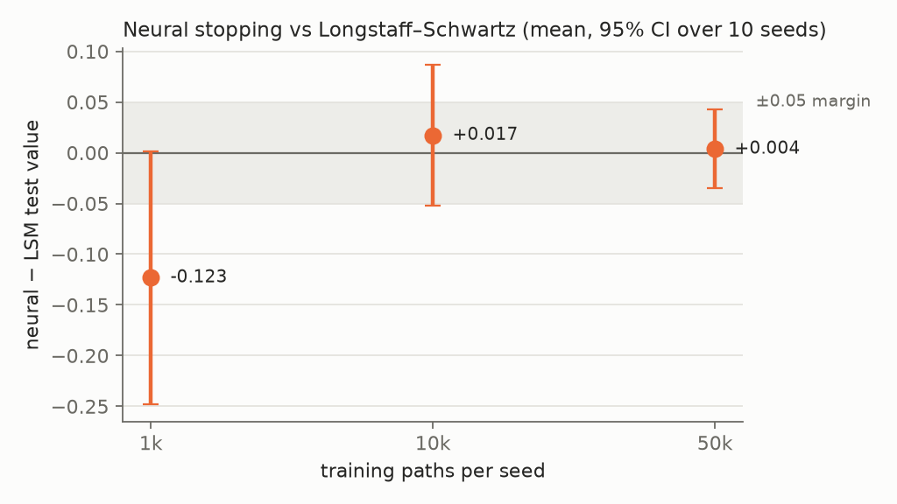
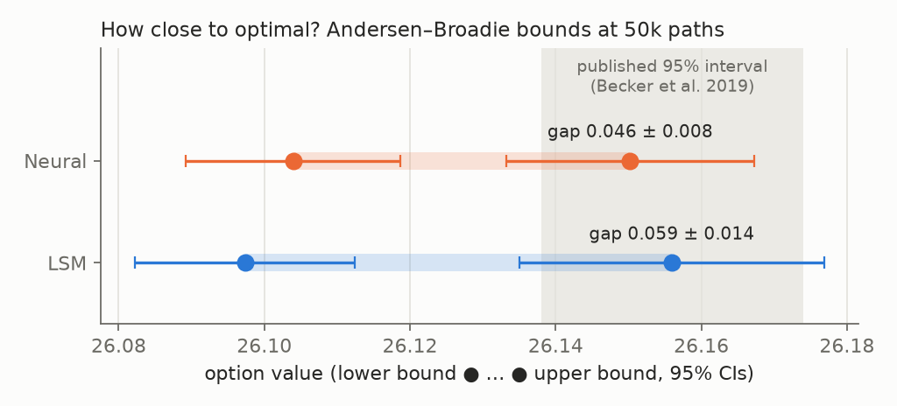

# Neural optimal stopping vs Longstaff–Schwartz

This project compares neural optimal stopping with Longstaff–Schwartz regression (LSM) for a five-asset Bermudan max-call. The question is whether a neural exercise rule offers a pricing advantage over a classical regression method, particularly when training data are limited. A separate primal–dual experiment estimates how close the resulting policies are to optimality.

All paths are simulated under risk-neutral geometric Brownian motion. This is a numerical pricing study, not a backtest on market data.

**Key findings**

- **With enough data, the methods tie.** At 50k training paths, neural stopping and tuned LSM price within 0.004 of each other (option value ≈ 26.1), with no detectable difference.
- **With little data, LSM is ahead.** At 1k paths LSM wins in 9 of 10 seeds, by about 0.12 on average (p = 0.053, so not significant at 5%).
- **Both policies are near-optimal.** An Andersen–Broadie primal–dual bracket puts both 50k policies within about 0.05 (≈ 0.2%) of the optimal value, and their upper bounds fall inside the published reference interval.
- **Built to survive review.** Paired evaluation on shared test paths, held-out validation, exact GBM simulation, independent 1D references (CRR tree and convolution) and 37 unit tests.

## Results

Both methods are evaluated on the same 200,000 held-out paths. Each training budget is repeated with ten training seeds; LSM's regression settings are selected on validation paths, while the neural training settings are fixed. Each seed also uses 5,000 validation paths, separate from the stated training budget and the shared test set.

| Training paths per seed | Neural − LSM | 95% CI across seeds |
|---:|---:|---:|
| 1,000 | −0.123 | [−0.248, +0.002] |
| 10,000 | +0.017 | [−0.052, +0.086] |
| 50,000 | +0.004 | [−0.035, +0.043] |

At 50k paths, there is no detectable difference between the two methods. At 1k, LSM achieves a higher value in nine of ten seeds, although the prespecified t-test narrowly misses the 5% threshold (p = 0.053). These intervals measure variation across training seeds **conditional on the shared test paths**. Including test-set uncertainty makes a ±0.05 equivalence claim at 50k inconclusive.



To check the distance to the optimal stopping value, I applied a nested Andersen–Broadie primal–dual estimator to one 50k-path policy from each method (seed 0). This is a separate experiment with 2,000 outer paths and 3,200 inner simulations per state and exercise date.

| Policy | Estimated policy value | Dual upper estimate | Estimated gap (95% CI) |
|---|---:|---:|---:|
| LSM | 26.097 | 26.156 | 0.059 [0.044, 0.073] |
| Neural | 26.104 | 26.150 | 0.046 [0.038, 0.055] |



The "estimated policy value" here is the policy's value from the dual experiment's inner simulations (about 6.4 million paths from the initial state). It is more precise than, and statistically consistent with, the same policy's value on the 200k test paths.

Both estimated gaps are small relative to an option value near 26.1. The policy values lie about 0.05 below the paper's own lower bound (≈ 26.156). This is expected: Becker et al. train each date on millions of freshly simulated paths, whereas this study caps training at 50k fixed paths per seed. The dual upper bound holds **in expectation**; the reported intervals account for outer-path sampling variation but not all finite-inner simulation bias. The estimates are consistent with the reference interval **[26.138, 26.174]** reported by Becker, Cheridito and Jentzen (2019), but do not certify either policy as optimal.

## Method

The option pays `max(max(S₁, …, S₅) − K, 0)` upon exercise. Its five independent underlying assets start at 100, with strike 100, risk-free rate 5%, dividend yield 10%, volatility 20%, maturity three years, and nine exercise dates (excluding time zero).

- **LSM:** Regress discounted continuation cash flows backwards on polynomial state features; choose regression degree and ridge penalty on validation paths.
- **Neural stopping:** Train a separate stopping network at each decision date using a differentiable stopping objective, with sorted asset inputs and the exercise payoff as features. The network settings are fixed rather than tuned through a full grid.
- **Evaluation:** Apply both learned exercise rules out of sample, with paired payoffs on the same simulated test paths. The population expected payoff of any admissible rule is a lower bound on the optimal value.
- **Validation:** Check the simulator and discounting, compare a one-dimensional Bermudan put with CRR and convolution references, and run martingale and dual-estimator diagnostics.

The full-study comparison covers the five-dimensional case. The proposed two-dimensional comparison, neural feature ablation, broader hyperparameter calibration and development-cost study were not completed. The detailed estimator definitions, statistical interpretation and validation limits are in [RESEARCH_NOTES.md](RESEARCH_NOTES.md).

## Code and results

| File | Contents |
|---|---|
| [`stopping.py`](stopping.py) | GBM simulation, LSM, neural stopping, policy evaluation |
| [`dual.py`](dual.py) | Nested primal–dual estimator |
| [`01_method_validation.ipynb`](01_method_validation.ipynb) | Numerical validation |
| [`02_calibration_and_preflight.ipynb`](02_calibration_and_preflight.ipynb) | Development and preflight checks |
| [`03_main_study.ipynb`](03_main_study.ipynb) | Experimental design and interpretation |
| [`results/`](results/) | Figures, summary tables and supporting records; see the [file index](results/README.md) |
| [`tests/`](tests/) | Unit tests |
| [`tools/`](tools/) | Primal–dual sizing and diagnostic scripts used while developing the dual experiment |

## Running the checks

The recorded study environment used **Python 3.14.4** and the versions in `requirements.txt`. On a Unix-like system:

```bash
python -m venv .venv
source .venv/bin/activate
python -m pip install -r requirements.txt
python -m unittest discover -v
python make_figures.py
```

The last command regenerates the two figures **from committed CSVs**, without running simulations. The notebooks on this branch default to quick smoke tests, not the full study.

The original frozen study is preserved at [`study-v1`](https://github.com/MoritzDue/bermudan-neural-stopping/tree/study-v1). Its archived execution has a disclosed source-hash mismatch, and the full run cannot currently be reproduced directly from this branch without additional local checkpoints and archival tooling. The committed figures and summary data remain available for inspection; see [reproducibility details](RESEARCH_NOTES.md#reproducibility-and-scope).

## References

- Becker, S., Cheridito, P., & Jentzen, A. (2019). [*Deep Optimal Stopping*](https://jmlr.org/papers/v20/18-232.html). *Journal of Machine Learning Research*, 20(74).
- Andersen, L., & Broadie, M. (2004). [*Primal-Dual Simulation Algorithm for Pricing Multidimensional American Options*](https://doi.org/10.1287/mnsc.1040.0258). *Management Science*, 50(9).
- Longstaff, F. A., & Schwartz, E. S. (2001). *Valuing American Options by Simulation: A Simple Least-Squares Approach*. *Review of Financial Studies*, 14(1).
